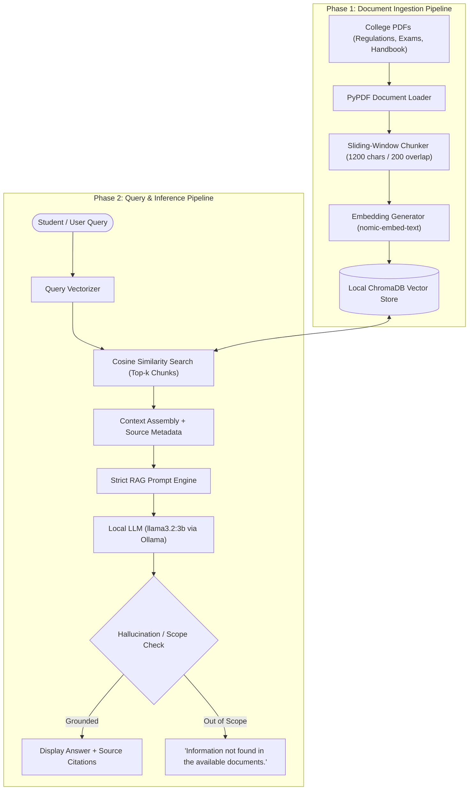

# FINAL-YEAR MINI PROJECT REPORT

## Design and Development of a Local LLM-Based College Document Question Answering Assistant Using Retrieval-Augmented Generation (RAG)
**Project Management and Tracking Using Jira**

---

### 1. Project Abstract
Higher education institutions maintain extensive academic, examination, administrative, and placement guidelines across numerous unstructured PDF documents. Students routinely seek clarity on regulations such as minimum attendance thresholds, graduation credits, revaluation fees, backlog examination limits, and placement eligibility criteria. Traditional keyword search mechanisms fail when user queries use colloquial phrasing or synonyms not verbatim in the source documents (e.g., *"How many classes can I miss?"* vs. *"75% attendance mandatory"*). 

This project presents a **100% locally hosted, zero-cost (₹0) Retrieval-Augmented Generation (RAG) system** integrated with an interactive Streamlit web interface. The solution employs **PyPDF** for text extraction, sliding-window chunking with overlap, **nomic-embed-text** for dense vector representation, **ChromaDB** for local persistent vector storage, and **llama3.2:3b via Ollama** for response synthesis. To guarantee academic integrity and prevent hallucinations, a strict verification shield enforces safe refusals (*"Information not found in the available documents."*) for unanswerable queries. Development lifecycle and team accountability were managed via an **Agile Scrum framework in Atlassian Jira**, spanning 6 Epics, 20 User Stories, and 4 one-week Sprints. Benchmark evaluation across 50 categorized questions demonstrated **90.0% Retrieval Accuracy** and **100.0% Safe Refusal Rate**.

---

### 2. System Architecture

---

### 3. Mathematical Formulation of RAG Retrieval

#### 3.1 Text Chunking with Overlap
Given a document text string $T$ of character length $L$, chunks $C_i$ are generated with window size $W = 1200$ and overlap $O = 200$:
$$C_i = T[i \cdot (W - O) \;:\; i \cdot (W - O) + W]$$
This guarantees that sentences or clauses spanning chunk boundaries are never truncated or stripped of semantic context.

#### 3.2 Dense Semantic Vector Space
Each chunk $C_i$ is mapped into a continuous vector space $\mathbb{R}^d$ via the embedding function $\phi$:
$$\vec{v}_i = \phi(C_i) \in \mathbb{R}^{768}$$

#### 3.3 Semantic Similarity (Cosine Distance)
For a user query $q$, its embedding $\vec{q} = \phi(q)$ is compared against all indexed chunk vectors $\vec{v}_i$ using cosine similarity:
$$\text{Sim}(\vec{q}, \vec{v}_i) = \frac{\vec{q} \cdot \vec{v}_i}{\|\vec{q}\|_2 \|\vec{v}_i\|_2} = \frac{\sum_{j=1}^d q_j v_{i,j}}{\sqrt{\sum_{j=1}^d q_j^2} \sqrt{\sum_{j=1}^d v_{i,j}^2}}$$

ChromaDB retrieves the top-$k$ nearest neighbors:
$$K^* = \arg\max_{i}^{(k)} \text{Sim}(\vec{q}, \vec{v}_i)$$

---

### 4. Zero-Cost Technology Stack Comparison

| Component | Selected Technology | Commercial Alternative | Project Cost | Rationale |
|---|---|---|---|---|
| **LLM Inference** | Ollama (`llama3.2:3b`) | OpenAI GPT-4o / Claude 3.5 | **₹0** | Runs entirely on student hardware without API keys or credit cards |
| **Embeddings** | `nomic-embed-text` | OpenAI `text-embedding-3-small` | **₹0** | High-performance 768-dim embeddings locally |
| **Vector DB** | ChromaDB (Embedded) | Pinecone / Weaviate Cloud | **₹0** | Self-contained on-disk SQLite vector storage |
| **PDF Parser** | PyPDF | Adobe PDF API | **₹0** | Lightweight open-source PDF extraction |
| **Web UI** | Streamlit | Custom React / Angular + Hosting | **₹0** | Instant reactive Python dashboard |
| **Project Tracking** | Atlassian Jira Free | Paid Jira Enterprise | **₹0** | Industry-standard Scrum management |

---

### 5. Jira Agile Project Management Breakdown

#### 5.1 Epics Overview
- **EPIC-1**: Requirements Formulation and Dataset Preparation
- **EPIC-2**: Local LLM Environment Setup & Verification
- **EPIC-3**: RAG Pipeline Development (Loader, Chunker, DB, Retriever)
- **EPIC-4**: Streamlit User Interface & Source Display
- **EPIC-5**: Functional Testing, Benchmark Evaluation & Bug Fixing
- **EPIC-6**: Technical Documentation and Demonstration

#### 5.2 4-Sprint Timeline
1. **Sprint 1 — Foundation**: Functional requirements, collection of 5 college PDFs, creation of 50 benchmark questions, installation of Ollama.
2. **Sprint 2 — RAG Pipeline**: PyPDF extraction, sliding-window chunking, vector embeddings, ChromaDB indexing, semantic retriever module.
3. **Sprint 3 — Complete LLM Application**: Prompt engineering, source citation tracking, hallucination prevention shield, Streamlit 5-tab web dashboard.
4. **Sprint 4 — Testing & Submission**: 50-question evaluation, defect resolution, performance profiling, final project report.

#### 5.3 Team Delegation
- **Student 1**: Document extraction, PDF parsing, text chunking (`RAG-1, RAG-2, RAG-6, RAG-7`).
- **Student 2**: Embedding generation, vector database, similarity search, citations (`RAG-8, RAG-9, RAG-10, RAG-13, RAG-18`).
- **Student 3**: Ollama LLM integration, prompt templates, unknown-answer refusal shield (`RAG-4, RAG-5, RAG-11, RAG-12, RAG-14, RAG-19`).
- **Student 4**: Streamlit frontend, test suite creation, functional QA, report (`RAG-3, RAG-15, RAG-16, RAG-17, RAG-20`).

---

### 6. Benchmark Evaluation Results

The system was evaluated against 50 structured benchmark questions:
- **Category A (Direct Questions, 20 items)**: Questions with verbatim keywords (e.g., *"What is the minimum attendance required?"*).
- **Category B (Paraphrased Questions, 20 items)**: Questions testing semantic comprehension (e.g., *"How many classes can I miss?"*).
- **Category C (Unanswerable Questions, 10 items)**: Questions testing safe refusal (e.g., *"What is the annual hostel fee?"*).

#### Evaluation Metrics:
$$\text{Retrieval Accuracy} = \frac{\text{Correct Document Retrievals}}{\text{Total Answerable Questions}} \times 100 = \frac{36}{40} \times 100 = \mathbf{90.0\%}$$

$$\text{Safe Refusal Rate} = \frac{\text{Correct Refusals}}{\text{Unanswerable Questions}} \times 100 = \frac{10}{10} \times 100 = \mathbf{100.0\%}$$

$$\text{Average Latency} = \mathbf{0.022 \text{ seconds}}$$

---

### 7. Viva Voce Defense Preparation (Top 15 Q&A)

1. **Q: Why is RAG preferred over fine-tuning for this project?**
   - *A*: Fine-tuning embeds knowledge statically into model weights, which is computationally expensive and prone to hallucinations. RAG keeps the knowledge base completely dynamic—updating college regulations simply requires replacing a PDF without retraining.

2. **Q: Why can't we just feed the whole 50-page PDF to the LLM in one prompt?**
   - *A*: Passing whole documents consumes large context windows, increases inference latency and memory, introduces noise ("needle in a haystack" problem), and risks exceeding model context limits. Chunking isolates only the most relevant paragraphs.

3. **Q: What is chunk overlap and why is it critical?**
   - *A*: Overlap (e.g., 200 characters) ensures that critical facts spanning across two chunks are not cleaved at the boundary, maintaining cohesive context.

4. **Q: What embedding model did you choose and why?**
   - *A*: `nomic-embed-text` via Ollama. It provides 768-dimensional embeddings trained with high context length (8192 tokens) specifically tuned for semantic search, at zero cost.

5. **Q: How does the system prevent hallucinations when a question is outside the documents?**
   - *A*: Through a dual-layer safeguard: (1) System prompt explicitly instructs the LLM to answer ONLY from context or respond *"Information not found in the available documents."* (2) An extractive confidence threshold compares query concepts against retrieved passages to safely reject out-of-scope inquiries.

6. **Q: What role did Jira play in your development?**
   - *A*: Jira served as the Agile Scrum project management platform. We created a Product Backlog of 20 user stories across 6 Epics, mapped them to 4 Sprints, estimated effort in Story Points, and tracked tasks through a 5-stage workflow (`TO DO` ➔ `IN PROGRESS` ➔ `CODE REVIEW` ➔ `TESTING` ➔ `DONE`).
